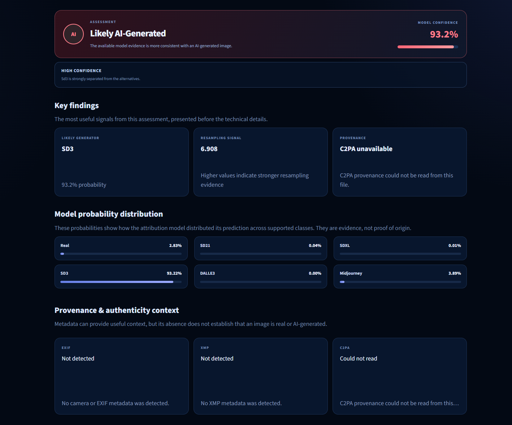
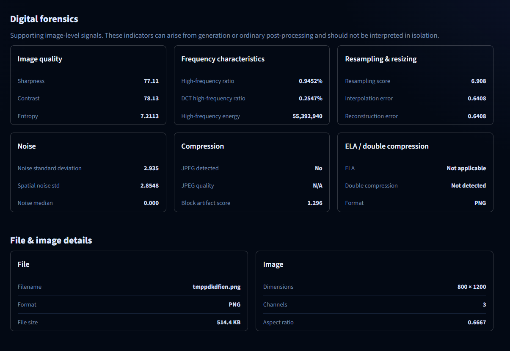
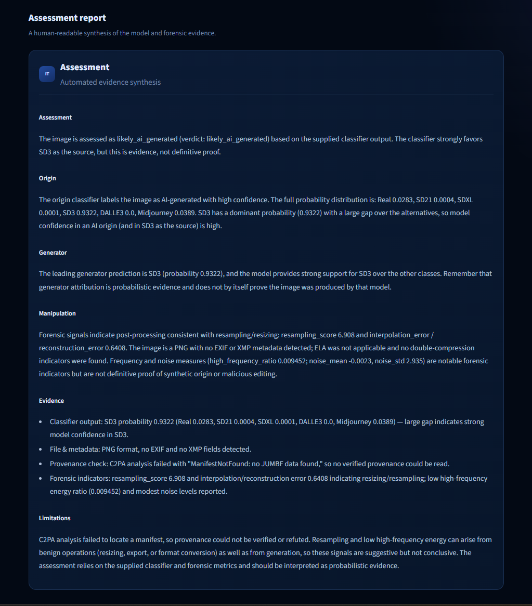
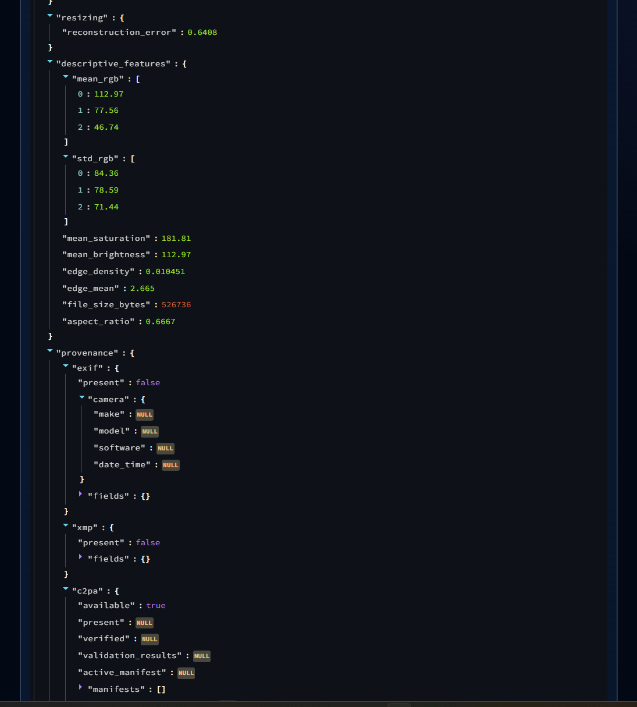
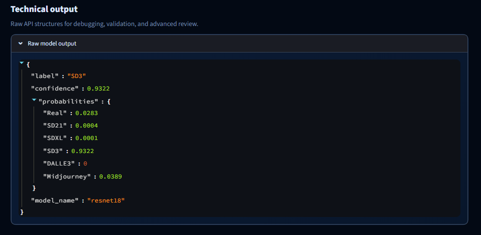
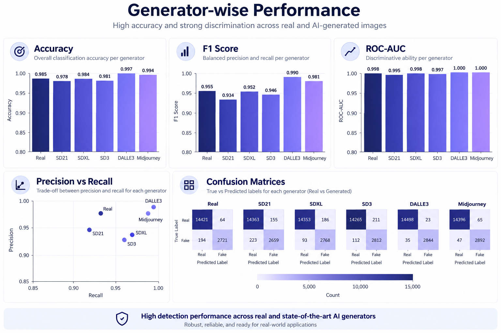

# Weesil

### AI Image Detection · Generator Classification · Digital Forensics · Provenance Analysis

Weesil is an AI image forensics platform designed to assess an image using a **single multiclass deep-learning classifier**. The model predicts the class that the image most closely matches, including **Real** and supported AI-generator classes such as **Midjourney, Stable Diffusion, and DALL·E**.

The model prediction is complemented by traditional digital forensics, metadata/provenance inspection, and an LLM-powered evidence report.

> **Weesil is an evidence-based analysis tool, not an absolute authenticity verifier.**

<p align="center">
  <a href="https://weesil.com/"><strong>Live Demo →</strong></a>
  &nbsp;&nbsp;|&nbsp;&nbsp;
  <a href="https://youtu.be/6vA5Qyj-kzg"><strong>Watch Demo Video →</strong></a>
</p>

---

# Demo

## Live Application

**[Try Weesil Live →](https://weesil.com/)**

Weesil is deployed on an **AWS EC2 instance** and exposed through its Streamlit interface.

### Product Demo Video

**[▶ Watch the Weesil Demo](https://youtu.be/6vA5Qyj-kzg)**

The demo showcases:

1. Image upload
2. Multiclass image classification
3. Predicted class and confidence
4. Digital forensic analysis
5. Provenance analysis
6. Automated evidence report
7. API structure

### Interface


---

### Key Findings and Provenance



---

### Forensics



---

### Report



---

### Forensic Analysis JSON



---

### Model Analysis JSON



---

# Overview

AI-generated images are becoming increasingly difficult to distinguish from authentic photographs through visual inspection alone.

Weesil approaches this problem as a **multi-signal image forensics task**. The core machine-learning component is a **single multiclass image classifier** that predicts the class an image most closely resembles.

The platform combines:

- A multiclass deep-learning image classifier
- Traditional image-forensic measurements
- Embedded metadata and provenance inspection
- Structured analysis and decision logic
- An LLM-powered evidence report

The classifier can distinguish between **Real** images and supported AI-generated classes. Generator predictions are model classifications rather than proof of origin.

---

# Key Features

## 1. Multiclass Image Classification

Weesil currently uses **one machine-learning model** for image classification.

The model predicts one of the supported classes, for example:

```text
Real
Midjourney
Stable Diffusion 2.1
Stable Diffusion XL
Stable Diffusion 3
DALL·E 3
```

The model produces a probability distribution across the supported classes. The highest-probability class is used as the primary model prediction.

Example:

```text
Model Prediction
────────────────
Midjourney

Confidence
──────────
93.19%
```

The classifier's prediction should be interpreted as a model-based assessment. A prediction for an AI-generator class does not establish that the image was definitively created by that generator.

---

## 2. Digital Image Forensics

Weesil supplements the model prediction with traditional forensic analysis using OpenCV, Pillow, and NumPy.

Current analysis includes:

### Image Properties

- Image dimensions
- Aspect ratio
- Color channels
- RGB statistics
- Saturation
- Brightness

### Statistical Analysis

- Entropy
- Contrast
- Sharpness
- Blur characteristics
- Noise residuals
- Noise distribution

### Edge & Frequency Analysis

- Edge density
- Edge statistics
- FFT frequency characteristics
- High-frequency energy
- Low-frequency energy

### Compression Analysis

- JPEG detection
- Estimated JPEG quality
- Block artifact analysis
- DCT statistics
- High-frequency DCT energy
- Double-compression indicators

### Image Manipulation Analysis

- Error Level Analysis (ELA)
- Resampling detection
- Interpolation error
- Reconstruction error
- Resizing characteristics

These measurements are supporting signals and are not individually treated as proof of AI generation.

---

## 3. Metadata & Provenance Analysis

Weesil analyzes available embedded metadata and provenance information.

### EXIF

The system can extract information such as:

```text
Camera Make
Camera Model
Software
Capture Date/Time
```

### XMP

XMP metadata is inspected for additional embedded information.

### C2PA

Weesil checks for **C2PA manifests** when available.

C2PA can provide digitally signed provenance information associated with an image.

> The absence of EXIF, XMP, or C2PA metadata does not prove that an image is AI-generated.

Metadata may be removed, modified, or lost during image processing.

---

## 4. Evidence-Based LLM Report

After the analysis is complete, Weesil generates a concise natural-language report.

The report can summarize:

- Model prediction
- Model confidence
- Provenance information
- Important forensic signals
- Supporting evidence
- Final assessment

The LLM does **not** independently classify the image. It receives structured analysis produced by the application and turns that information into a human-readable report.

```text
Image
  │
  ▼
Multiclass ML Classifier
  │
  ├───────────────┐
  │               │
  ▼               ▼
Model Output    Forensics
  │               │
  └───────┬───────┘
          │
          ▼
     Provenance
          │
          ▼
 Structured Analysis
          │
          ▼
          LLM
          │
          ▼
 Human-readable Report
```

---

# System Architecture

```text
                         ┌───────────────────┐
                         │    Image Upload   │
                         └─────────┬─────────┘
                                   │
                                   ▼
                         ┌───────────────────┐
                         │    Streamlit      │
                         │    Frontend       │
                         └─────────┬─────────┘
                                   │ HTTP
                                   ▼
                         ┌───────────────────┐
                         │     FastAPI       │
                         │      :8000        │
                         └─────────┬─────────┘
                                   │
                                   ▼
                         ┌───────────────────┐
                         │    LangGraph      │
                         │ Analysis Workflow │
                         └─────────┬─────────┘
                                   │
              ┌────────────────────┼────────────────────┐
              │                    │                    │
              ▼                    ▼                    ▼
     ┌─────────────────┐  ┌──────────────────┐  ┌─────────────────┐
     │ Multiclass      │  │ Digital          │  │ Provenance      │
     │ AI Classifier   │  │ Forensics        │  │ Analysis        │
     │                 │  │                  │  │                 │
     │ ResNet18        │  │ OpenCV/Pillow    │  │ EXIF/XMP/C2PA   │
     └────────┬────────┘  └────────┬─────────┘  └────────┬────────┘
              │                    │                    │
              └────────────────────┼────────────────────┘
                                   │
                                   ▼
                         ┌───────────────────┐
                         │ Structured        │
                         │ Analysis          │
                         └─────────┬─────────┘
                                   │
                                   ▼
                         ┌───────────────────┐
                         │ LLM Report        │
                         │ Generation        │
                         └─────────┬─────────┘
                                   │
                                   ▼
                         ┌───────────────────┐
                         │ Streamlit UI      │
                         └───────────────────┘
```

## Production Deployment Flow

The current public deployment follows this infrastructure path:

```text
Browser
   ↓ HTTPS
Cloudflare
   ↓
AWS Elastic IP
   ↓
Nginx :443
   ↓
Docker Compose
   ├── Streamlit :8501
   │       ↓
   │   FastAPI :8000
   │       ↓
   │   AI Model (.pth)
   │
   └── Environment (.env)
```

This separates the public HTTPS entry point from the application containers while keeping the trained model inside the backend inference service.

---

# How It Works

## Step 1 — Image Upload

The user uploads an image through the Streamlit interface.

The original image is sent to the FastAPI backend for analysis.

## Step 2 — Multiclass Model Prediction

The single trained classifier processes the image and produces probabilities for all supported classes.

The highest-probability class becomes the primary model prediction.

## Step 3 — Digital Forensics

Traditional forensic measurements are calculated independently from the model prediction.

## Step 4 — Provenance Analysis

EXIF, XMP, and C2PA information is inspected when available.

## Step 5 — Structured Analysis

The model prediction, confidence, forensic measurements, and provenance information are assembled into a structured analysis result.

## Step 6 — Evidence Report

The structured analysis is passed to the LLM, which produces a concise explanation of the available evidence.

---

# Model Evaluation

Weesil currently uses **one multiclass image-classification model**.

## Multiclass Classifier

**Architecture:** ResNet18

**Task:** Multiclass classification

The classifier predicts across the supported image classes, including:

```text
Real
SD21
SDXL
SD3
DALL·E 3
Midjourney
```

The model produces a probability distribution across these classes and uses the highest-probability class as the primary prediction.

### Generator-wise Performance

The model is evaluated using multiple performance metrics across each supported class, including **Accuracy, F1 Score, ROC-AUC, Precision, and Recall**.

The chart below is a placeholder for the final evaluation visualization:

> **TODO:** Add the final generator-wise performance chart to the repository at `assets/generator-performance.png`.



The evaluation visualization compares model performance across **Real, SD21, SDXL, SD3, DALL·E 3, and Midjourney**.


# Technology Stack

| Component | Technology |
|---|---|
| Machine Learning | PyTorch |
| Model Architecture | ResNet18 |
| Image Processing | OpenCV |
| Image Metadata | Pillow |
| Numerical Computing | NumPy |
| API | FastAPI |
| Workflow Orchestration | LangGraph |
| LLM Integration | LangChain |
| LLM | OpenAI |
| UI | Streamlit |
| Data Validation | Pydantic |
| Database | SQLAlchemy |
| Provenance | EXIF / XMP / C2PA |
| Cloud Deployment | AWS EC2 |

---

# Project Structure


```text
Weesil/
│
├── app/
│   ├── __init__.py
│   │
│   ├── backend/
│   │   └── main.py
│   │
│   ├── configs/
│   │   ├── config.py
│   │   └── __init__.py
│   │
│   ├── database/
│   │   ├── database.py
│   │   ├── db_models.py
│   │   └── init_db.py
│   │
│   ├── frontend/
│   │   ├── streamlit_app.py
│   │   └── assets/
│   │       ├── logo_persona.png
│   │       ├── logo_persona_tagline.png
│   │       └── new_logo.png
│   │
│   ├── models/
│   │   ├── forensics_analyzer.py
│   │   ├── generator_attributor.py
│   │   ├── llm.py
│   │   └── __init__.py
│   │
│   ├── schemas/
│   │   └── predictions.py
│   │
│   ├── services/
│   │   ├── analysis_service.py
│   │   ├── analyze_provenance.py
│   │   └── __init__.py
│   │
│   ├── tests/
│   │   ├── testing.py
│   │   ├── test_analysis_service.py
│   │   ├── test_forensics.py
│   │   └── test_model_inference.py
│   │
│   └── workflows/
│       ├── analysis_graph.py
│       └── __init__.py
│
├── assets/
│   ├── analysis_report.png
│   ├── forensic_analysis_json.png
│   ├── generator-performance.png
│   ├── model_analysis_json.png
│   ├── real-ai-confusion-matrix.png
│   ├── real-ai-roc-curve.png
│   ├── ui.png
│   ├── ui_element.png
│   └── ui_with_image.png
│
├── data/
│   ├── dataloader.py
│   ├── dataloader_defactify.py
│   ├── dataset.py
│   ├── dataset_defactify.py
│   ├── download_dataset.py
│   ├── test_dataloader.py
│   └── __init__.py
│
├── models/
│   ├── detector.py
│   └── __init__.py
│
├── src/
│   ├── test_gpu.py
│   ├── test_model.py
│   ├── __init__.py
│   │
│   ├── evaluation/
│   │   ├── evaluate.py
│   │   ├── evaluate_bin.py
│   │   ├── evaluate_generators.py
│   │   └── evaluate_generator_model.py
│   │
│   └── training/
│       ├── test_path.py
│       ├── train.py
│       ├── train_bin_defactify.py
│       ├── train_generator_model.py
│       └── train_multi_defactify.py
│
├── tests/
│   ├── test_dataset.py
│   └── test_generator.py
│
├── .dockerignore
├── .gitattributes
├── .gitignore
├── compose.yaml
├── Dockerfile.backend
├── Dockerfile.frontend
├── LICENSE
├── README.md
├── requirements.txt
├── requirements_backend.txt
├── requirements_frontend.txt
```

> **Note:** Update the structure above if the final repository layout differs.

---

# AWS EC2 Deployment

Weesil is deployed on an **AWS EC2 instance** using Docker Compose, with Cloudflare and Nginx handling the public HTTPS entry point.

### Production Architecture

```text
Browser
   ↓ HTTPS
Cloudflare
   ↓
AWS Elastic IP
   ↓
Nginx :443
   ↓
Docker Compose
   ├── Streamlit :8501
   │       ↓
   │   FastAPI :8000
   │       ↓
   │   AI Model (.pth)
   │
   └── Environment (.env)
```

### Deployment Components

- **Browser** — User-facing access to the application
- **Cloudflare** — DNS, proxying, and HTTPS/TLS
- **AWS Elastic IP** — Stable public endpoint for the EC2 instance
- **Nginx :443** — HTTPS reverse proxy
- **Docker Compose** — Orchestrates the application containers
- **Streamlit :8501** — Web application frontend
- **FastAPI :8000** — Backend API and inference service
- **AI Model (.pth)** — Trained multiclass image-classification checkpoint
- **`.env`** — Runtime configuration and secrets

The deployment demonstrates:

- AWS EC2 provisioning
- Elastic IP configuration
- Cloudflare DNS/proxy configuration
- Nginx reverse-proxy configuration
- HTTPS access
- Docker and Docker Compose
- Streamlit frontend deployment
- FastAPI backend deployment
- Remote model inference


# Design Principles

### Single Multiclass Model

The current ML pipeline uses one classifier to predict the supported image classes rather than separate real-vs-AI and generator-attribution models.

### Evidence Over Claims

Forensic metrics and metadata are presented as observations and supporting signals.

### Model Prediction Is Not Proof

A high-confidence generator classification does not establish the original source or generator of an image.

### Provenance Is Supporting Evidence

EXIF, XMP, and C2PA information can provide useful provenance evidence but does not independently establish authenticity.

### LLM as an Explanation Layer

The LLM converts structured analysis into a human-readable report rather than acting as the primary image classifier.

---

# Limitations

Weesil should be considered an **experimental forensic analysis system** rather than a definitive authenticity authority.

### Image Classification

- ML classifiers can produce false positives and false negatives.
- Performance can vary across datasets and image domains.
- Images from unseen generation methods may be difficult to classify reliably.
- The classifier can only directly represent classes included in its training/evaluation setup.

### Generator Classification

- Generator classification is limited to supported classes.
- High confidence does not prove the original generator.
- An image generated by an unseen model may be classified as the closest supported class.

### Digital Forensics

- Resizing, recompression, screenshots, and editing can alter forensic signals.
- Individual forensic indicators should not be interpreted as definitive evidence.

### Metadata & Provenance

- EXIF/XMP metadata can be removed or modified.
- C2PA information may not be present.
- Absence of provenance does not establish authenticity.

---

# Future Work

- [ ] Calibrate model confidence scores
- [ ] Expand generator classes
- [ ] Improve cross-generator generalization
- [ ] Evaluate robustness against compression and resizing
- [ ] Add adversarial robustness testing
- [ ] Expand provenance visualization
- [ ] Add batch image analysis
- [ ] Add model explainability visualizations
- [ ] Improve inference performance
- [ ] Add automated evaluation pipelines
- [ ] Improve cloud deployment scalability
- [ ] Add HTTPS/reverse-proxy production configuration

---

# Roadmap

```text
[x] Multiclass image classifier
[x] Traditional image forensics
[x] EXIF analysis
[x] XMP analysis
[x] C2PA analysis
[x] LangGraph analysis workflow
[x] Structured analysis pipeline
[x] LLM evidence report
[x] Streamlit interface
[x] AWS EC2 deployment

[ ] Final benchmark documentation
[ ] Model performance visualizations
[ ] Confidence calibration
[ ] Expanded generator coverage
[ ] Robustness evaluation
[ ] Production deployment improvements
```

---


# Why Weesil?

Weesil demonstrates an end-to-end applied AI system rather than an isolated machine-learning model.

The project combines:

```text
Deep Learning
      +
Computer Vision
      +
Digital Forensics
      +
Metadata / Provenance
      +
Workflow Orchestration
      +
LLM Integration
      +
REST API
      +
Cloud Deployment
      +
Interactive UI
```

The project covers the path from model inference and evidence extraction to API design, workflow orchestration, user interface, and cloud deployment.

---


# Author

**Zaki Ansari**

- GitHub: [zakiansari07-art](https://github.com/zakiansari07-art)
- LinkedIn: [linkedin.com/in/zaki-ansari-b54a53194](https://linkedin.com/in/zaki-ansari-b54a53194)

---

# Disclaimer

Weesil provides an automated assessment based on machine-learning predictions, forensic signals, and available provenance information.

Results such as a **Real** or AI-generator classification represent the system's assessment based on the available evidence and should not be interpreted as definitive proof of an image's origin.
